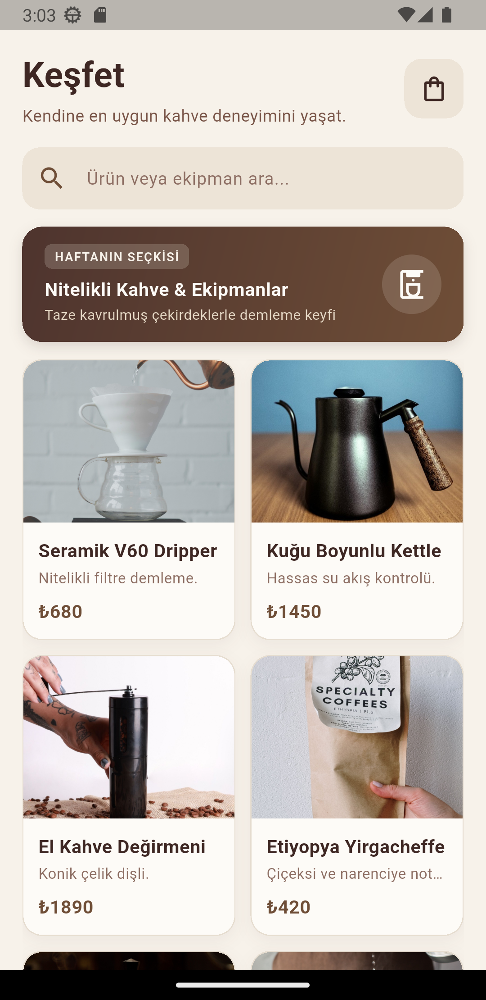
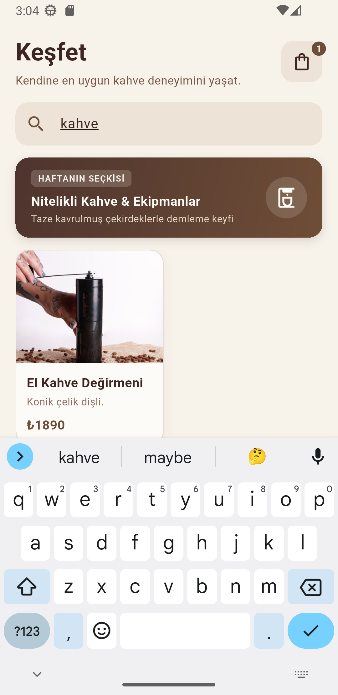
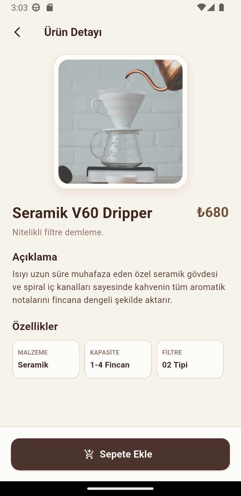
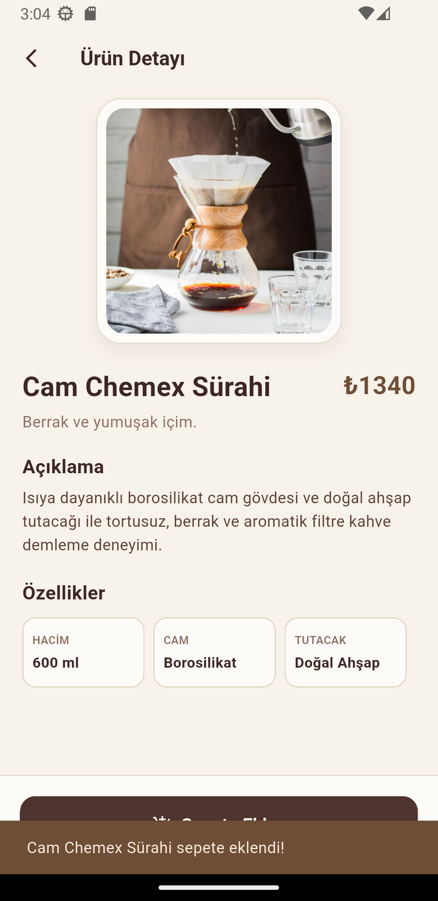
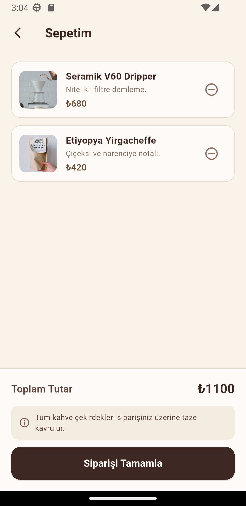
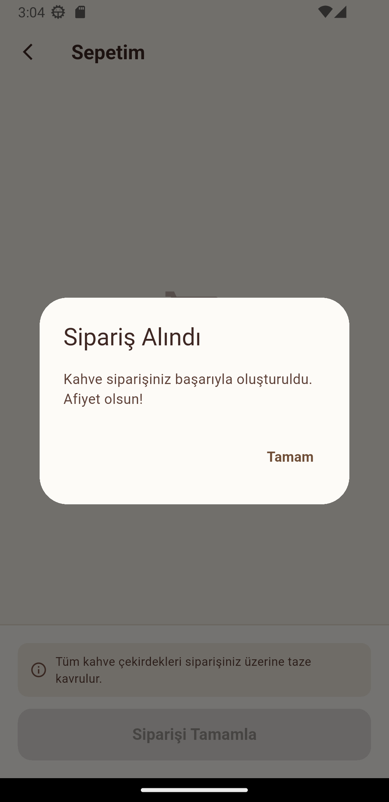
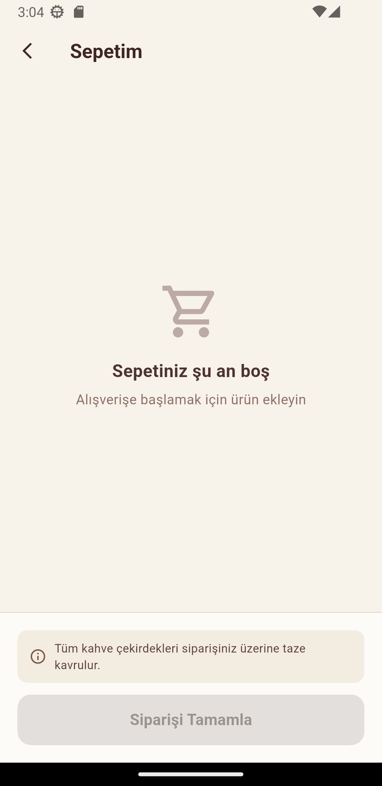

# Mini Kahve Kataloğu Uygulaması

Kahve ve nitelikli kahve ekipmanlarını inceleyebileceğiniz, ürün detaylarını görüntüleyebileceğiniz ve sepet yönetimi yapabileceğiniz Flutter tabanlı mobil katalog uygulaması.

## Özellikler

- **Keşfet (Ana Sayfa):** 2 sütunlu `GridView` ürün kartları, kahve temalı özel kampanya banner'ı, anlık arama/filtreleme ve sepet ürün sayısı rozeti.
- **Ürün Detay Sayfası:** `Named Routes` ve `Route Arguments` ile veri aktarımı, ürün açıklaması, teknik özellik kutuları ve `SnackBar` bildirimli sepete ekleme.
- **Sepet Yönetimi:** Sepete eklenen ürünleri listeleme, ürün çıkarma, toplam tutar hesaplama, boş sepet durumu ve sipariş onay penceresi simülasyonu.
- **Mimari:** Temiz klasör yapısı (`models`, `data`, `screens`, `widgets`), JSON simülasyonu (`fromJson` / `toJson`) ve yerel asset yönetimi (`Image.asset`).

## Kullanılan Teknolojiler ve Sürüm Bilgisi

- **Flutter SDK:** 3.50.0 (Channel stable)
- **Dart SDK:** 3.x
- **Paketler:** Yalnızca varsayılan `material.dart` kütüphanesi kullanılmıştır (harici paket bulunmamaktadır).

## Kurulum ve Çalıştırma Adımları

1. Depoyu bilgisayarınıza klonlayın:
```bash
git clone [https://github.com/cerenbilgi/mini-katalog.git](https://github.com/cerenbilgi/mini-katalog.git)
cd mini_katalog
```

2. Gerekli bağımlılıkları yükleyin:
```bash
flutter pub get
```

3. Uygulamayı başlatın (Android Emulator veya Chrome üzerinde):
```bash
flutter run
```

## Ekran Görüntüleri

| Keşfet (Ana Sayfa) | Arama ve Filtreleme | Ürün Detayı |
| :---: | :---: | :---: |
|  |  |  |

| Sepete Eklendi Bildirimi | Dolu Sepet | Sipariş Onayı | Boş Sepet |
| :---: | :---: | :---: | :---: |
|  |  |  |  |
